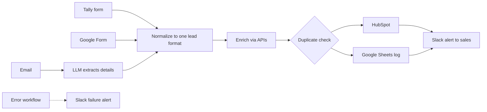

# Company RAG Assistant

A chat assistant built in n8n that answers team questions from internal company documents, customer information, and APIs.

> **Note:** Built for client work. Code, screenshots, and client details are confidential. This page describes the approach only.

## The Problem
Company knowledge was spread across documents and systems, and people had to search through files or ask colleagues for answers that already existed. The same questions came up repeatedly, and questions about customers meant digging through records by hand.

## How It Works
1. **Ingest:** Company documents are loaded, split into chunks, embedded, and stored in n8n's vector store.
2. **Refresh:** The knowledge base is re-ingested on a regular schedule so it reflects the latest documents.
3. **Ask:** A team member sends a question in chat.
4. **Retrieve:** The agent searches the vector store for the most relevant passages. For customer questions and live data, it calls internal APIs through HTTP tools.
5. **Answer:** The model replies using what it retrieved, with conversation memory so follow-up questions work.

## Architecture

## Problems Solved
- **Stale information.** Regular retrieval keeps the knowledge base current, so the assistant isn't answering from outdated documents.
- **Customer questions.** I gave the agent access to customer information, so it can answer account-related questions directly instead of sending people to look them up.
- **Made-up answers.** The system prompt tells the agent to answer only from retrieved content and to say when it doesn't know.
- **Poor retrieval.** Chunk size and overlap were adjusted so passages kept enough context to be useful.
- **Data access.** The assistant only has access to the documents and data it was given.

## Tools
n8n · Claude / Gemini · n8n Vector Store · REST APIs

## Outcome
Saved team members time searching for information and reduced repeat questions to colleagues.

## Contact
onwukwetc@gmail.com · [LinkedIn](https://www.linkedin.com/in/tochukwu-onwukwe-9931651b5)
